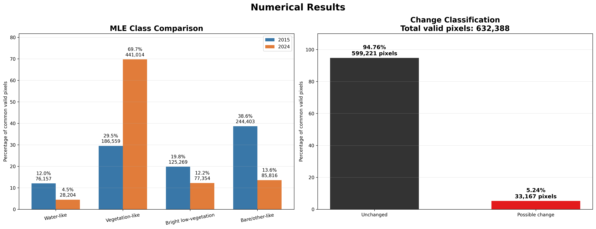
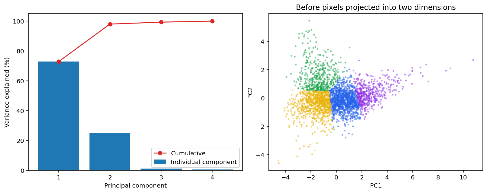
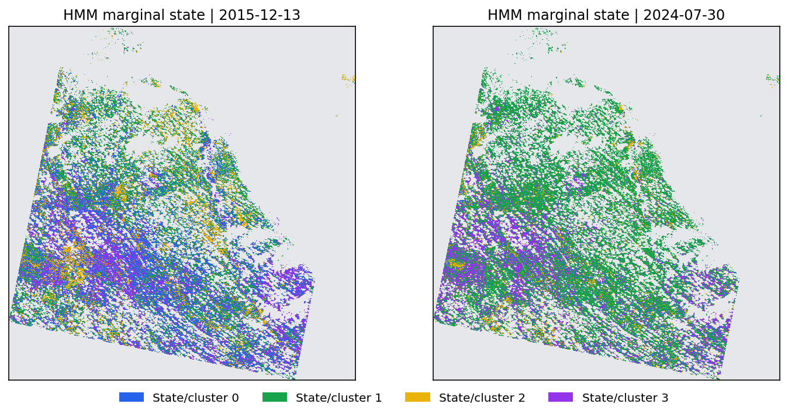
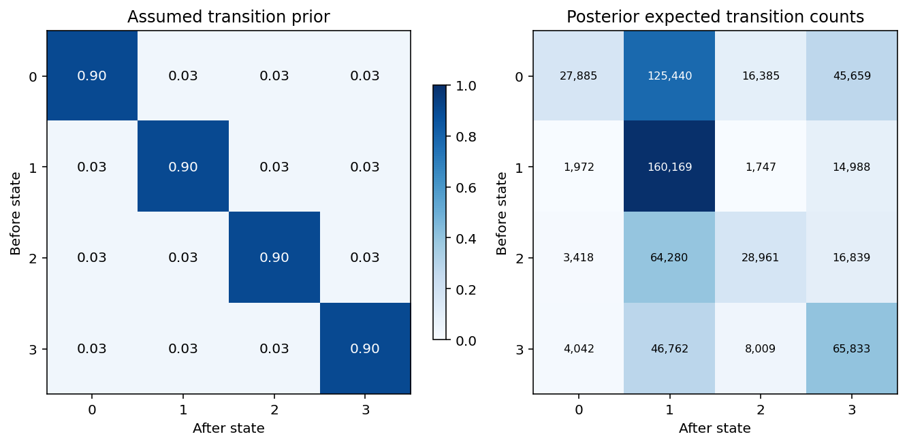
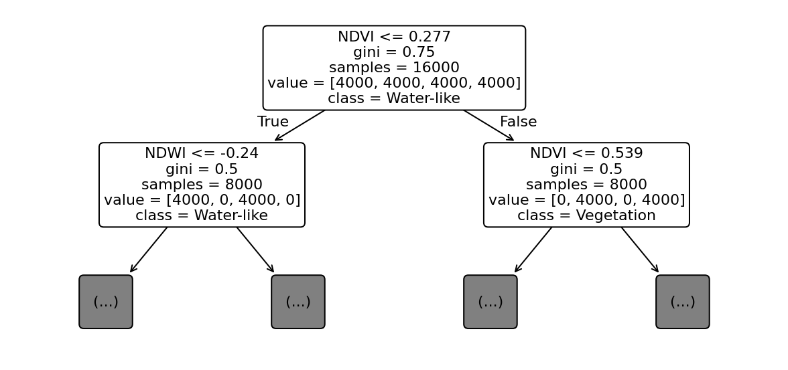
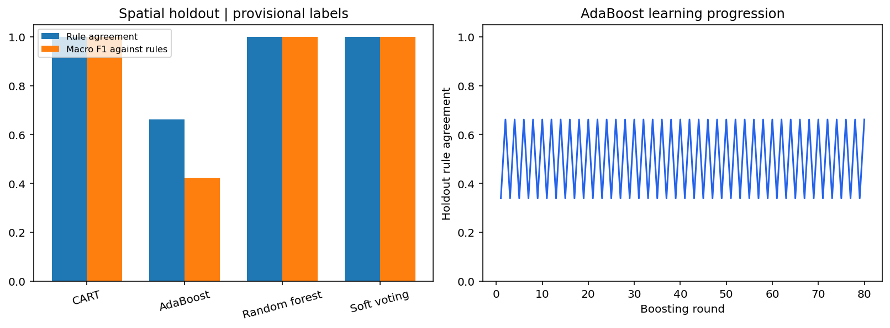

# Landsat Spectral Change Analysis

Consolidated project report covering PBL 1, PBL 2 and PBL 3. Prepared for the project demonstration requirements supplied on 19 November 2026.

Student names, register numbers, institution, course title and faculty details should be completed before submission. No student identity or institutional approval is assumed in this report.

Abstract. This project compares two Landsat 8 Collection 2 Level-2 acquisitions using a common quality-masked geographic grid. The existing baseline demonstrates provisional maximum-likelihood classification and linear-regression residual analysis. The extension adds K-means, principal component analysis, a two-date hidden Markov model with exact sum-product inference, CART, AdaBoost, random forests and soft voting. Supervised evaluation uses a buffered spatial holdout and provisional spectral-rule targets. The work demonstrates the assigned algorithms on real imagery; it does not establish independent land-cover accuracy or validated urban-growth estimates.

| Component | Assigned coverage | Assessment |
| --- | --- | --- |
| PBL 1 | Existing MLE and regression baseline; confirm original assignment wording | Weight not supplied |
| PBL 2 | K-means, PCA, Hidden Markov Model and Sum Product Algorithm | 20 marks |
| PBL 3 | Boosting, Ensemble Learning and CART | 10 marks |
| Report | Consolidated methodology, results, evaluation and reproduction | PBL 1 to PBL 3 |

The preserved baseline flags 33,167 of 632,388 common valid pixels, or 5.24%, as possible spectral change. This percentage is a threshold exceedance rate, not an accuracy score.

## 1 Introduction Objectives and Dataset

The problem is to explore differences between two multispectral acquisitions while showing how several machine-learning and probabilistic-inference methods operate on the same inputs. The objectives are to preserve the original data and baseline, align both dates, explore spectral groups, summarize variance, infer latent states, compare supervised rule-reproduction models and provide a reproducible class demonstration.

| Property | Verified value |
| --- | --- |
| Satellite | Landsat 8 only in the supplied dataset |
| Dates and path row | 13 December 2015 and 30 July 2024; path/row 146040 |
| Product | Collection 2 Level-2 L2SP surface reflectance |
| Inputs | SR_B2 blue, SR_B3 green, SR_B4 red, SR_B5 near infrared and QA_PIXEL per date |
| Size | 10 original GeoTIFF files totaling 767,745,918 bytes |
| Native grid | 7681 rows by 7531 columns; 30 m pixels; EPSG:32643 |
| Analysis grid | 1537 by 1507; approximately 150 m pixels |
| Study extent | Full scene footprint; no administrative Noida boundary was supplied |

Both dates are aligned to the Before red-band reference. Native scene origins differ by 2100 m in the east-west direction. Reflectance is calculated as DN times 0.0000275 minus 0.2. QA_PIXEL bits 0 through 5 exclude fill, dilated cloud, cirrus, cloud, cloud shadow and snow. Zero/nodata reflectance samples are excluded. Water remains valid. No QA_RADSAT band is available, so the mask does not identify every saturated pixel.

A grid factor of five reduces computation for the class demonstration. Nearest-neighbor resampling preserves categorical quality flags. All comparison maps use the common valid footprint. December and July differ seasonally; the analysis cannot attribute every spectral difference to physical land-cover change.

## 2 PBL 1 Existing Baseline

The original project supplies the PBL 1 baseline. It derives provisional spectral-rule samples, estimates multivariate Gaussian class means and covariances, and assigns the maximum-likelihood class to valid spectra. The labels Water-like, Vegetation-like, Bright low-vegetation and Bare/other-like are demonstration labels rather than independently verified land cover.

For each band, ordinary least-squares regression predicts After reflectance from Before reflectance using up to 100,000 sampled common pixels. The residual vector is standardized by each band's median absolute residual. Its root-mean-square score is compared with a robust threshold: median score plus three times 1.4826 times the median absolute deviation. Large residuals indicate possible spectral change.

| Band | Slope | Intercept | Sample R squared | Common pixel RMSE |
| --- | --- | --- | --- | --- |
| SR_B2 | 0.5444 | 0.0206 | 0.0674 | 0.0352 |
| SR_B3 | 0.5517 | 0.0472 | 0.0720 | 0.0376 |
| SR_B4 | 0.5766 | 0.0288 | 0.1167 | 0.0464 |
| SR_B5 | 0.3170 | 0.2814 | 0.0256 | 0.0896 |



Some earlier class-count figures use each date's own valid footprint; direct comparisons should use common-area summaries. No confusion matrix against independently collected labels exists for this baseline. The formal PBL 1 topic list was not supplied and must be checked against the instructor's original assignment.

## 3 PBL 2 K Means Clustering and PCA

K-means minimizes the within-cluster sum of squared distances from each standardized four-band spectrum to its assigned centroid. The demonstration fixes k at four, uses k-means++ initialization with ten restarts and random seed 42, and fits at most 20,000 Before training-area spectra. Applying those same centroids to both dates retains a common cluster-ID system. Cluster IDs are arbitrary and must not be interpreted as supervised class IDs.

The fitted training inertia is 24175.23; the silhouette score on a sample of up to 1,500 training points is 0.3424. These describe spectral grouping under the chosen scale and k, not classification accuracy. No claim of optimal k is made.

PCA is fitted to the same standardized Before training sample. It finds orthogonal directions of decreasing variance. The two-dimensional scatter plot is exploratory; the four-band K-means and HMM do not discard components based on this projection. Thus the demonstration does not claim that PCA improves classification performance.

| Component | Variance explained | Cumulative |
| --- | --- | --- |
| PC1 | 72.92% | 72.92% |
| PC2 | 25.07% | 97.99% |
| PC3 | 1.30% | 99.29% |
| PC4 | 0.71% | 100.00% |



| Cluster | Blue | Green | Red | Near infrared |
| --- | --- | --- | --- | --- |
| 0 | 0.0651 | 0.0972 | 0.1036 | 0.1964 |
| 1 | 0.0447 | 0.0825 | 0.0686 | 0.2876 |
| 2 | 0.0443 | 0.0748 | 0.0684 | 0.1955 |
| 3 | 0.0859 | 0.1216 | 0.1389 | 0.2113 |

## 4 PBL 2 Hidden Markov Model

For each valid geographic pixel, the two four-band spectra are observations x1 and x2. Hidden variables z1 and z2 represent four latent spectral groups. The factorization is p(z1,z2,x1,x2) = pi(z1) e1(x1|z1) A(z1,z2) e2(x2|z2). Initial state frequencies use smoothed Before cluster frequencies. Emissions use diagonal Gaussian means and variances estimated from the Before training clusters, with a variance floor of 0.02 in standardized units.

The transition matrix assumes a 0.90 probability of retaining the same state over the entire 2015-to-2024 interval. Each alternative state receives 0.10 divided by three. This is a user-inspectable prior, not a learned transition probability, an annual persistence rate or evidence that 90% of the landscape stayed physically unchanged. With only two acquisitions, reliable temporal dynamics cannot be learned from this demonstration.

| Before to After | State 0 | State 1 | State 2 | State 3 |
| --- | --- | --- | --- | --- |
| State 0 | 0.9000 | 0.0333 | 0.0333 | 0.0333 |
| State 1 | 0.0333 | 0.9000 | 0.0333 | 0.0333 |
| State 2 | 0.0333 | 0.0333 | 0.9000 | 0.0333 |
| State 3 | 0.0333 | 0.0333 | 0.0333 | 0.9000 |



The mean model-dependent posterior probability of different latent states is 0.5527. It is not directly comparable to the baseline 5.24% threshold flag: the two methods define and model different quantities. The HMM posteriors are not calibrated probabilities of real land-cover change.

## 5 PBL 2 Sum Product Inference

Sum-product computes exact marginal probabilities on the chain factor graph. The forward message multiplies the current emission by the sum of previous forward-message and transition products. The backward message sums the transition, next emission and next backward-message products. Their normalized product gives the smoothed state marginal. Combining adjacent messages and factors gives the joint posterior over the two states. The implementation operates in log space with logsumexp to prevent numerical underflow.

```text
alpha[t,j] = e[t,j] * sum_i(alpha[t-1,i] * A[i,j])
beta[t,i] = sum_j(A[i,j] * e[t+1,j] * beta[t+1,j])
gamma[t] = normalize(alpha[t] * beta[t])
P(different states | observations) = 1 - sum_i P(z1=i,z2=i | x1,x2)
```

The procedure sums all possible hidden-state paths. It does not perform Viterbi max-product decoding, and the independently most probable marginal states need not form the most probable joint path. On a chain, forward-backward is the sum-product implementation; HMM and sum-product are shown as a model and its inference algorithm rather than falsely presented as unrelated models.



The app includes actual pixel examples with reflectance values, marginal probabilities and the full four-by-four joint posterior. A persistence slider recomputes one selected pixel only. Saved scene maps remain at the default prior. Unit checks compare a three-step, two-state chain with exhaustive enumeration and verify both state and pairwise normalization, including extreme log-emission values.

## 6 PBL 3 CART Boosting and Ensembles

The supervised experiment uses blue, green, red, near-infrared, NDVI and NDWI features. Training-area quantiles define Water-like, Vegetation-like, Bright low-vegetation and Bare/other-like rules. Only pixels matching exactly one rule receive a weak label; overlaps and unmatched pixels are excluded. Rule thresholds are computed before evaluation using the training area alone. A maximum of 4,000 training examples per class is sampled using seed 42.

| Model | Implementation and fixed settings |
| --- | --- |
| CART | DecisionTreeClassifier; binary Gini splits; maximum depth 6; minimum leaf size 25 |
| AdaBoost | 80 sequential decision stumps; learning rate 0.5; sample weights emphasize difficult examples |
| Random forest | 80 bootstrapped randomized trees; maximum depth 10; minimum leaf size 10 |
| Soft voting | Equal average of the three fitted class-probability outputs, then choose the largest |

CART supplies an interpretable single-tree baseline. AdaBoost demonstrates boosting, while the random forest demonstrates bagging and feature randomization. Soft voting demonstrates combination across different fitted learners. Class probabilities are not externally calibrated. Hyperparameters are fixed rather than selected by maximizing displayed holdout scores. A simpler model can score better when the target is itself a deterministic spectral rule.



## 7 Evaluation Design and Measured Results

The eastern quarter of common valid Before pixels is held out, with an eight-analysis-column guard strip separating it from the training area. The spatial masks contain 469,452 training-area pixels, 158,536 test-area pixels and 4,400 excluded guard pixels. The final weak-labelled samples contain 16,000 training points and 12,000 held-out points. This reduces immediate pixel mixing but does not eliminate all large-scale spatial autocorrelation.

Evaluation compares predictions with the held-out provisional rules, not independently surveyed land cover. Rule agreement is the matching fraction; macro F1 averages the four class F1 values with zero for undefined values; balanced rule agreement averages recall over reference classes present in the holdout. All models use the same samples. After maps are unvalidated transfer predictions and are not used to report labelled test performance.

| Model | Rule agreement | Macro F1 | Balanced agreement |
| --- | --- | --- | --- |
| CART | 0.9997 | 0.9998 | 0.9998 |
| AdaBoost | 0.6615 | 0.4231 | 0.5000 |
| Random forest | 0.9996 | 0.9991 | 0.9998 |
| Soft voting | 0.9997 | 0.9998 | 0.9998 |

| Class | Training examples | Holdout examples |
| --- | --- | --- |
| Water-like | 4000 | 193 |
| Vegetation-like | 4000 | 3869 |
| Bright low-vegetation | 4000 | 2827 |
| Bare/other-like | 4000 | 5111 |



## 8 Interpretation of Predictions and Errors

The following CART confusion matrix compares held-out provisional rules with predictions. Rows are reference rule classes and columns are predicted classes. All four model matrices are available at full size in the app and course_results.json.

| Reference to predicted | Water-like | Vegetation-like | Bright low veg | Bare other |
| --- | --- | --- | --- | --- |
| Water-like | 193 | 0 | 0 | 0 |
| Vegetation-like | 0 | 3869 | 0 | 0 |
| Bright low-vegetation | 0 | 0 | 2827 | 0 |
| Bare/other-like | 0 | 4 | 0 | 5107 |

Confusion counts reveal which provisional rules are difficult for each fitted model to reproduce in the eastern holdout. High scores can arise because the features include the same NDVI, NDWI and brightness information used to construct the targets. Such agreement demonstrates implementation and approximation of a weak-label task, not independent scientific confirmation of land cover.

Impurity-based feature importances and CART rules explain the fitted decision process but are not causal evidence. The four After prediction maps reveal how models transfer to a different season and year; they are not validated by the Before holdout scores. Likewise, K-means cluster IDs are not interchangeable with the four supervised class IDs. Both are explicitly labelled in the app.

The report does not claim that ensembles must beat a single tree, that PCA improves supervised accuracy, that the two-date HMM has learned environmental dynamics, or that the baseline change percentage measures urban growth. Independent validation would be necessary for each stronger claim.

## 9 Reproduction and Project Demonstration

The public repository is https://github.com/Nithyon/landsat-change-explorer. The README links to the Drive folder holding all source imagery. Eight bands are direct GeoTIFF downloads; two bands use numbered transfer parts because complete-file uploads timed out. prepare_data.py restores the original bytes and validates SHA-256 hashes. The tested environment is Windows with Python 3.14 and the pinned package versions below.

| Package | Measured version |
| --- | --- |
| numpy | 2.5.3 |
| scipy | 1.17.1 |
| scikit-learn | 1.8.0 |
| rasterio | 1.5.0 |
| matplotlib | 3.10.8 |
| streamlit | 1.65.0 |

```text
python prepare_data.py
python -m pip install -r requirements.txt
python build_pbl_demo.py
python -m pip install -r requirements-report.txt
python build_project_report.py
python -m unittest discover -s tests -q
python -m streamlit run app.py
```

Open History to present PBL 1. Open Course demo for K-means, PCA, HMM and sum-product, then show CART, AdaBoost, random forest, soft voting and the spatial holdout. Adjust the example-pixel persistence slider and explain that the saved scene maps do not change. The combined notebook exposes these stages in execution order. Saved figures allow demonstration without retraining during class.

Verification checks include baseline numerical regression, exact HMM inference versus enumerated paths, normalized marginals, isolation of unsupervised fitting from held-out and After data, disjoint buffered split masks, exclusion of ambiguous weak labels, and app interaction without retraining. Generated figures and the report should be inspected before submission. Cross-platform clean installation and independent ground-truth validation are outside the verified scope.

## 10 Limitations Conclusion and References

The supplied inputs span different seasons and nearly nine years. Cloud screening, residual atmospheric effects, the coarser demonstration grid and full-scene extent constrain interpretation. There are only two observations per pixel. Transition persistence is assumed; emissions use a simplified diagonal Gaussian model. The four latent groups may not correspond to stable semantic land-cover types. The supervised target is a spectral rule, and evaluation excludes ambiguous or unmatched pixels, so scores cannot be generalized to every pixel or to real land-cover accuracy.

The project now demonstrates every supplied PBL 2 and PBL 3 topic within one Landsat workflow and preserves the existing PBL 1 baseline. K-means provides spectral groups, PCA provides variance-based exploration, the HMM defines a two-date latent-state model, sum-product provides exact chain inference, CART provides decision rules, AdaBoost provides sequential boosting and the forest and voting models provide ensemble examples. The measurements support a reproducible teaching demonstration rather than a validated environmental assessment.

Future work should define an explicit study boundary, acquire comparable-season observations and more dates, collect independent labelled validation samples, assess spatially separated generalization and uncertainty, and test sensitivity to cluster count, transition assumptions and label quality. Confirm the exact PBL 1 rubric and complete the student details before final submission.

1. [USGS Landsat Collection 2 Quality Assessment Bands](https://www.usgs.gov/landsat-missions/landsat-collection-2-quality-assessment-bands)

2. [USGS Landsat Collection 2 Fact Sheet](https://pubs.usgs.gov/fs/2021/3002/fs20213002.pdf)

3. [scikit-learn 1.8 Clustering user guide](https://scikit-learn.org/1.8/modules/clustering.html)

4. [scikit-learn 1.8 PCA and decomposition user guide](https://scikit-learn.org/1.8/modules/decomposition.html)

5. [scikit-learn 1.8 Decision Trees user guide](https://scikit-learn.org/1.8/modules/tree.html)

6. [scikit-learn 1.8 Ensembles user guide](https://scikit-learn.org/1.8/modules/ensemble.html)

7. [Michael Collins The Forward Backward Algorithm](https://www.cs.columbia.edu/~mcollins/fb.pdf)

Numerical evidence comes from outputs/terminal_demo_results.json and outputs/pbl/course_results.json generated from the supplied imagery. Implementation is in landsat_analysis.py and pbl_analysis.py. No claims of independent accuracy are imported from the references.
